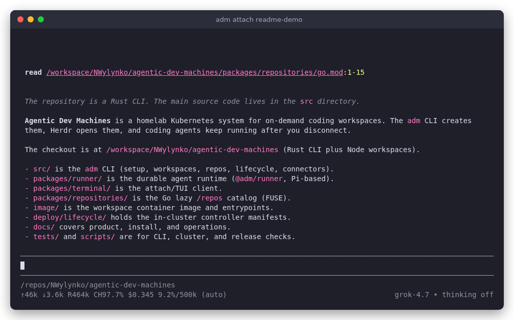
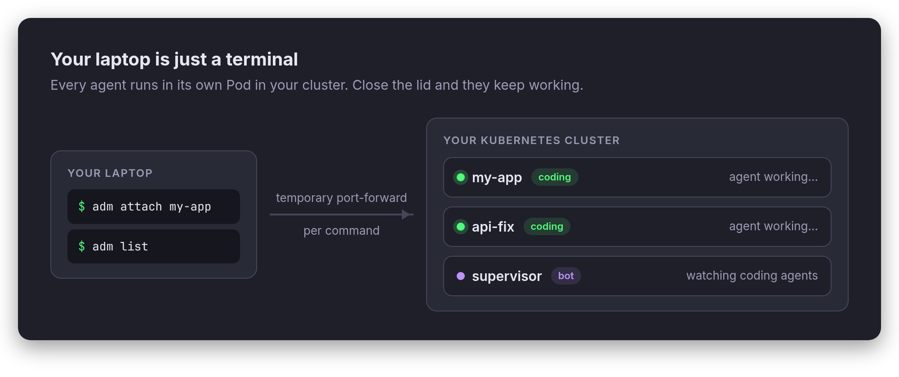
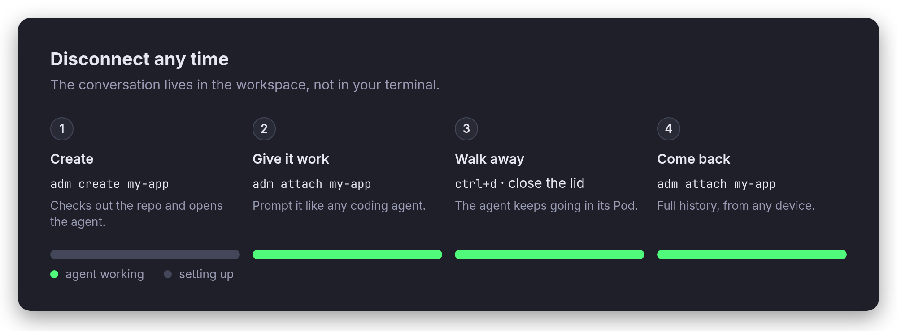
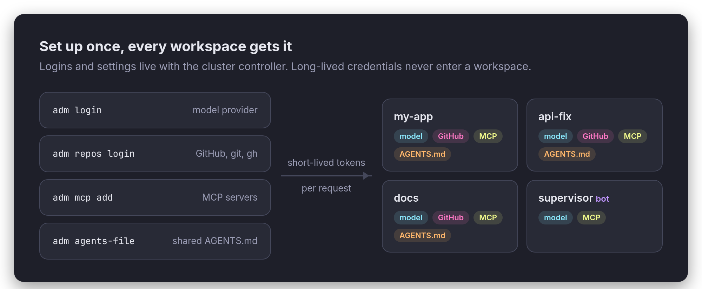
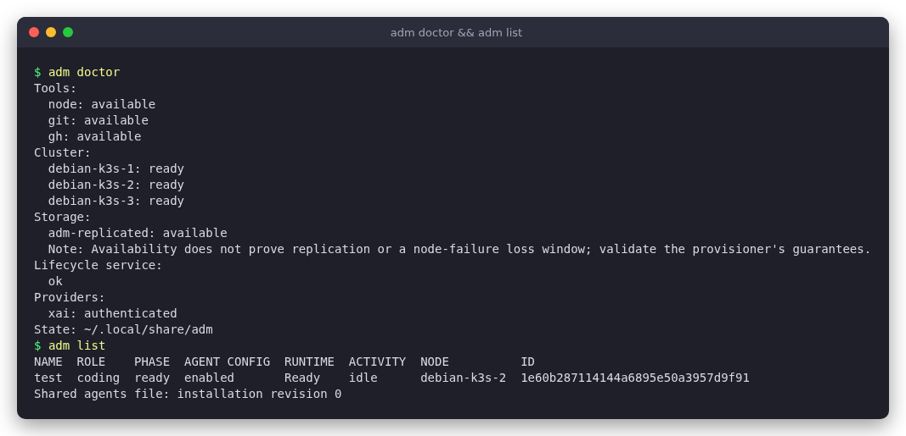

# Agentic Dev Machines

On-demand development workspaces on your own Kubernetes cluster, driven from your laptop with `adm`. Every workspace runs a durable coding agent in its own Pod, so you can close the lid and it keeps working.



## How it works







Each workspace has a stable ID that survives Pod restarts and node moves. A workspace only works while it holds a lease from the cluster controller, so a stale Pod can never act for it. Bots are workspaces with no repository, shell or coding tools; they direct coding agents through the controller.

## Install

On macOS (x86_64/arm64) or Linux (amd64/arm64) with Node.js 24+:

```sh
curl -fsSL https://raw.githubusercontent.com/NWylynko/agentic-dev-machines/main/install.sh | sh
```

This installs the release CLI, workspace runtime and terminal into `~/.local/bin`. Add that directory to your PATH. You don't need a clone, Rust, Go or npm. Run `adm update` later to update the CLI and controller. Running workspaces keep going. See [installation](docs/installation.md) for pinned versions, prerequisites and updates.

## Quick start

You need `kubectl` access to a cluster with a [StorageClass](deploy/storage.md) configured.

```sh
adm setup                 # pick images, storage class and default model; install the controller
adm login                 # sign in to a model provider, once for the whole installation
adm repos login           # connect GitHub so every workspace can clone, push and use gh
adm create my-project --repo OWNER/REPO
```

`adm create` waits for the workspace to become ready, checks out the repo into `/repos/OWNER/REPO`, and drops you into the agent. Everyday commands:

```sh
adm list                     # every workspace, its node and what the agent is doing
adm attach my-project        # talk to the agent
adm shell my-project         # zsh in the workspace, starting in the repo
adm port my-project 3000     # forward a dev server to localhost
adm destroy my-project
```



On another laptop, `adm connect` uses an existing installation without installing anything in the cluster.

## Next steps


- **Repositories:** `adm repos clone OWNER/REPO` registers a repo once and it shows up in every coding workspace under `/repos`, fetched the first time you open it. `adm create --repo OWNER/REPO --branch feature/x` starts on a branch, and `--new-repo OWNER/NAME` creates a new private GitHub repo. See [finding your repositories](docs/operations.md#find-your-repositories).
- **MCP servers:** `adm mcp add NAME URL` gives every agent a remote MCP server, signed in through your browser. See [MCP connectors](docs/operations.md#mcp-connectors).
- **Shared instructions:** `adm agents-file` edits one `AGENTS.md` that is prepended for every coding agent. See [shared agents file](docs/operations.md#shared-agents-file).
- **Bots:** `adm create supervisor --role bot` runs an agent that watches and directs your coding agents. See [bot workspaces](docs/operations.md#bot-workspaces).
- **Herdr:** `adm create my-project --herdr` opens the workspace in a new Herdr space. Optional close-event cleanup destroys the workspace when you close the space. See [Herdr](docs/operations.md#herdr-ownership-and-deletion).
- **Troubleshooting:** `adm doctor` checks the client, cluster and providers, and `adm system-log` merges the controller's logs. See [errors and recovery](docs/operations.md#errors-and-recovery).

For everything else, see [operations](docs/operations.md) for commands and verification, [the implementation contract](docs/implementation-contract.md) for APIs, and [product requirements](docs/product-requirements.md) for design and open decisions.

## Status

Early alpha. [Linux client checks](docs/client-validation-2026-10-18.md) cover shared workspace identity, agents that keep running after disconnect, and reconnecting to completed history. These are not yet validated live: native macOS/arm64, recovery after a node failure, live Herdr close delivery, and shared-provider sessions.

## License

[MIT](LICENSE). Bundled dependencies retain their own licenses.
