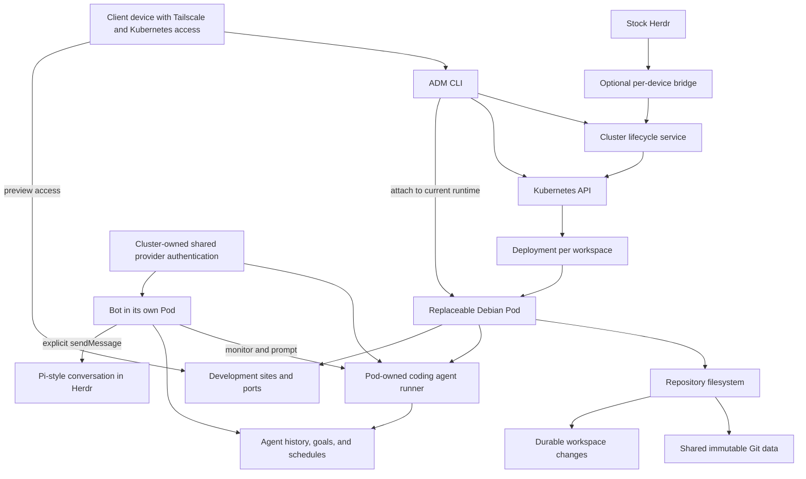

# Product requirements and design notes

These notes distinguish confirmed requirements, implemented local behavior, and proposals that still need validation. For installation and everyday use, start with the [README](../README.md) and [operations guide](operations.md).

The implementation target changed on 2026-10-16: all agent execution and durable state belong in workspace Pods; the management host is an access plane. Placement proposals in the earlier investigation below are historical.

Decisions confirmed on 2026-10-18 further define the target: clients already have Tailscale and Kubernetes access; ordinary ADM use needs no permanent management host or mandatory client daemon. A stock-Herdr bridge is optional per device, provider login is shared across the installation, and default updates leave active workspace images and agents running. These are requirements, not claims of implemented behavior; current setup still uses a systemd connection service and workspace-local provider login.

## Confirmed requirements

- Preserve repository work and agent history across runtime replacement. Installed tools are temporary or supplied by the base image.
- Isolate each workspace's files and Git state, even when two workspaces use the same repository and branch name.
- Accept some recent work loss during a rare, unexpected node failure. No exact loss window has been selected.
- Keep agents running autonomously while their workspace exists, including when nobody is connected.
- Treat explicit manual Herdr space removal delivered by the optional bridge as workspace destruction: stop execution and remove the dev container and its private files. Never infer deletion when the bridge is unavailable.
- Use Pi-style terminal interaction inside Herdr for development work and bot conversations.
- Bots have no repository access or coding tools. They can monitor and prompt coding agents, use Code Mode to compose permitted tools, and manage their own goals and recurring work.
- Bot model output stays private unless it calls `sendMessage` to publish a message in the terminal conversation.
- Support browser automation and a way to access development sites and ports from client laptops.
- Support ordinary CLI use from any device with existing Tailscale and Kubernetes access, independently of Herdr integration.
- Share one account per provider per installation across all existing and new coding and bot agents.
- Update the CLI and owned cluster services by default; update existing workspace images and agents only at the user's explicit request.
- Leave conversation retention after removal undecided; configurability is an acceptable proposal rather than a blocker.

## The experience

Users run ADM from devices that already belong to their Tailscale network and can access the Kubernetes cluster. Lifecycle management, durable execution, and shared provider authentication belong in the cluster. Ordinary commands do not require a permanent management host or client daemon. The transport mechanics remain an implementation choice; a separate public sign-in service is not required.

Users can independently enable a Herdr-to-ADM/cluster bridge, tunnel, or service on each device. It must work with stock Herdr. Disconnecting a device or stopping its bridge leaves workspaces and agents running; bridge availability affects Herdr event delivery rather than ordinary CLI access.

Creating a new Herdr space should give you a ready-to-use shell somewhere in the cluster without choosing a node, finding a Pod, or managing Kubernetes resources by hand.

A typical session should look like this:

1. Create a workspace from the CLI or Herdr.
2. Attach to its shell.
3. Open a repository under `/repos/example-owner/<repo>` or clone one normally.
4. Make changes yourself or run a coding agent through the Pi-style terminal interface. Optionally use a bot to monitor and prompt the agent.
5. Disconnect while agents continue working, then return to the same named workspace later.
6. Destroy the workspace when finished, directly through ADM or through an explicit Herdr removal event delivered by the enabled bridge; its owned activity stops and its development runtime and private files are destroyed.

Workspaces are quick to allocate and disposable when finished, but may run unattended until explicitly destroyed. The development image is built from `image/Dockerfile`. The published linux/amd64 copy is `ghcr.io/nwylynko/agentic-dev-machines:latest`.

Nodes may have constrained storage, so creating more workspaces should avoid multiplying complete repository checkouts, Git history, and machine images.

## Workspace model

A **workspace** is the resource the user creates and returns to. It has a stable identity, runtime configuration, and references to any persisted files and agent sessions.

Creating a new space with a previously used label gives it a new identity. Old goals, scheduled work, and delayed recovery attempts must not attach to it just because the name matches.

A **runtime** is the current container or machine executing its commands. It can be replaced without creating a new workspace.

A **Herdr space**, when associated through the optional integration, owns the workspace's lifetime. Multiple panes attach to the same workspace rather than each allocating another runtime. A delivered manual removal event triggers destruction; terminal disconnection or bridge unavailability does not.

A **coding agent** executes development work inside that workspace. A **bot** is a separate agent role with monitoring, prompting, messaging, and goal/loop tools, running in its own workspace Pod. It has no development filesystem or coding tools and does not receive a `/repos` mount. Whether a bot has its own Herdr space or shares the interface of a coding workspace remains open; ownership must be explicit in either case.

There are several separate recovery goals:

| State                                                          | Intended behavior                                                      | Design status                                             |
| -------------------------------------------------------------- | ---------------------------------------------------------------------- | --------------------------------------------------------- |
| Workspace identity and configuration                           | Survive terminal disconnection and runtime replacement                 | Core requirement                                          |
| Repository edits, untracked work, local commits, and Git state | Recover after replacement, subject to the accepted failure-loss window | Required; storage implementation remains open             |
| Agent history, goals, pending work, and loop definitions       | Recover and continue automatically without a human reconnecting        | Required; backend compatibility needs proving             |
| Installed tools and changes outside persisted paths            | Temporary; shared tools belong in the base image                       | Confirmed persistence boundary                            |
| Running processes and shell commands                           | Stop when their runtime dies                                           | Transparent process recovery is outside the initial scope |

Some recent work loss is acceptable after an unexpected node failure. Availability after a drain does not imply instant recovery. Storage, scheduling capacity, failure detection, and the agent backend determine the actual recovery time and loss window.

## CLI

The executable is `adm`. Lifecycle commands below are implemented. `create` still needs a cluster and the `adm-replicated` StorageClass from `deploy/storage.md`; the CLI tests drive them through a fake kubectl.

```sh
# Allocate a named workspace and wait until it can accept a shell.
adm create my-project --model PROVIDER/MODEL_ID

# Open another connection to an existing workspace.
adm attach my-project

# See workspaces and their current lifecycle state.
adm list

# Inspect readiness, recovery progress, storage, and connection errors.
adm status my-project

# Destroy the workspace, equivalent to removing its Herdr space.
adm destroy my-project
```

Every workspace has a durable agent. A model can be seeded through `adm setup` or `--model`, or selected later in `adm attach` with `/model`; requests wait until selection. Installed releases default to their matching published workspace image unless setup chooses another; source development defaults to the published `latest` image. Pass `--image adm-dev:0.1.0` for a local build. Without `--catalog`, `/repos` is an ordinary writable directory. Supplying a catalog opts in to lazy repository mounts; discovery and scoped private-repository fetch credentials are separate prerequisites.

Creation and attachment are separate operations. Losing an attachment must not delete the workspace. Reattaching should resolve the current runtime from the workspace identity instead of remembering a particular Pod name.

Commands should show provisioning and recovery progress and fail clearly when they cannot proceed. Repeating or interrupting an operation must not leave duplicate allocations or unreported resources behind. `destroy` and manual Herdr space removal must use the same destruction operation.

Forking a workspace could be useful later: reuse its Git baseline and create an independent writable view for another experiment or agent. Suspend, reset, snapshots, and sharing are also later possibilities rather than part of the first command set.

### Updates

The confirmed target for `adm update` is to update the CLI, controller, and other owned cluster services while leaving active workspace images and agents running. Existing workspaces must have an explicit upgrade operation at the user's discretion. It must show the expected interruption and preserve workspace identity, private files, and agent history. Exact command syntax for workspace upgrades remains open. This target is separate from the current installer update followed by `adm setup`.

## CLI, service, and Kubernetes

The cluster-owned workspace manager owns lifecycle operations and resolves a workspace to its current runtime. The CLI exposes those operations; the optional Herdr bridge integrates through the same interface.

The CLI uses the client's existing Kubernetes access to reach cluster services and scoped workspace runtimes. Kubernetes resources hold the desired workspace configuration. A supervised agent runner operates inside its owning workspace Pod, independently of CLI processes, terminal attachments, and SSH connections.

Autonomous execution and durable scheduling are core requirements and remain cluster-owned. No client process must stay running to own an agent, its durable state, or its provider login. Connection transport and the internal implementation of shared authentication remain design work.



This diagram shows the target ownership and connection paths, not settled transport details. Persisting the whole operating system is outside the current requirements.

| Component                      | Responsibility                                                                                                                  |
| ------------------------------ | ------------------------------------------------------------------------------------------------------------------------------- |
| CLI / workspace manager        | Expose cluster-owned lifecycle operations and resolve stable workspace identities from any authorized client                    |
| Herdr / terminal integration   | Present Pi-style conversations and optionally propagate explicit space removal through a user-enabled per-device bridge         |
| Kubernetes                     | Schedule runtimes and reconcile their desired existence                                                                         |
| Repository filesystem          | Discover repositories, fetch contents on demand, and enforce private writable views and Git state                               |
| Persistent storage             | Make selected workspace state recoverable on another node                                                                       |
| Agent runner / backend         | Execute unattended with role-specific tools, persist history and goals, schedule work, and recover independently of attachments |
| Shared provider authentication | Make one account per provider per installation available to all coding and bot agents without a client remaining connected      |
| Bot control interface          | Expose authenticated discovery and lifecycle/runtime controls without development filesystem or shell access                    |
| Terminal message adapter       | Deliver explicit bot messages to its Pi-style conversation in Herdr                                                             |
| Preview access                 | Route client connections to development sites and selected ports in the current runtime                                         |

An initial implementation could use one single-replica Deployment per workspace, identified by labels and annotations, plus storage resources where needed. There is no initial requirement for a custom cluster scheduler, database, Kubernetes operator, or Workspace CRD. Reuse the chosen agent backend's durable execution and scheduling where suitable.

### Herdr integration

The desired mapping is one Herdr space to one workspace, with several panes allowed to attach to it. Creating or reopening a space should create or resolve that association and launch the shell connection.

The user chooses whether to set up a bridge/tunnel/service on each device. It must support stock Herdr without a custom build, and other ADM commands must work without it. Bridge unavailability must be visible. The current Herdr API offers no replay cursor for missed events, so eventual delivery of close events during an outage is not guaranteed; a missing space or lost connection must never be interpreted as deletion.

The exact Herdr commands and lifecycle hooks need testing against the installed version. In particular, test how remote agents appear to Herdr's process detection and session restoration.

The user-facing conversation surface is the terminal in Herdr, using Pi or a Pi-style client. Integrating a durable runner with that interface still needs proving; a working remote harness must not be assumed to have a ready-made Pi terminal attachment. A separate web chat or external messaging service is not required.

Closing a pane or disconnecting a terminal leaves the workspace and agents running. An explicit manual removal event delivered by the bridge destroys the associated workspace. A Herdr process restart or temporary loss of its control connection must not be mistaken for deliberate space removal.

Destruction marks the workspace as deleted before stopping its agents and cancelling its pending work, recurring loops, and tool access. It then removes the runtime and private workspace files. Recovery and scheduling must respect that deletion so delayed work cannot recreate the workspace. If cleanup is interrupted, finish it on recovery. Shared upstream caches and changes already pushed to GitHub are not workspace-local files.

Repository work and agent history are durable for the lifetime of the workspace; durability does not imply keeping a deleted workspace alive. Configurable conversation retention after removal is an acceptable proposal. A retained archive is read-only history, not an active agent, goal, or schedule; the default retention policy remains open.

### Runtime replacement

The intended recovery sequence is:

1. The runtime disappears during a drain or node failure.
2. Any active attachment reports the interruption; recovery proceeds even if nobody is attached.
3. Kubernetes provisions a new runtime when compute and storage are available.
4. The runtime mounts or restores the workspace's persisted state.
5. The supervised agent runner resumes recoverable pending work and schedules automatically.
6. Any active attachment reconnects to the same workspace identity.

The old shell process does not move to the new runtime. An interrupted tool command may have partially changed files or external systems; agent recovery must account for that before retrying it.

### Browser automation and development ports

Development workspaces must support browser automation and access to their running sites or selected ports from client laptops. The browser location, automation integration, and port transport are implementation choices; Docker builds and other additional workloads have not been selected as requirements.

Preview connections should resolve the workspace's current runtime so replacement does not require finding a new Pod address. Exact URLs and reconnection behavior depend on the chosen transport. Removing a workspace must remove its routes or forwards too. Preview access does not grant access to another workspace's files. Browser capabilities for bots are not implied by this development-workspace requirement.

## Repositories available on demand

The desired filesystem exposes the accessible GitHub repository catalog inside each workspace:

```text
/repos/
└── example-owner/
    ├── project-alpha/
    ├── project-beta/
    └── project-gamma/
```

Repository names should be discoverable without cloning all their contents. Opening a repository prepares its working tree; reading a file fetches the required content. A large catalog should not delay getting the first shell.

The intended baseline is `main`. Repositories whose default branch has another name need an explicit policy. The proposed approach is to resolve a baseline commit when a repository is first opened and keep that base stable until an explicit Git operation changes it. Upstream movement should not silently rewrite active work.

Every development workspace must have an independent writable repository view and private Git state. To reduce storage use, the proposed model shares immutable upstream Git objects and stores each workspace's changes separately:

```text
GitHub repository at commit X
              │
      Shared immutable base
         ┌────┴────┐
         │         │
   Workspace A  Workspace B
     changes     changes
```

Both workspaces see the same repository path, while edits remain independent. This applies equally to `main` and to any other branch name. Branch names, refs, indexes, local commits, and writable filesystem metadata are private to each workspace. Published upstream content can be shared; unpushed work must not become visible through a shared mutable cache.

Isolation must be enforced by mounts and access permissions. A coding workspace must not be able to mount, inspect, modify, or attach to another workspace through filesystem access or management credentials. A bot's broad lifecycle/runtime interface is a separate capability; it permits monitoring and control of live coding agents by immutable ID while denying direct repository access, shell access, and general cross-workspace credentials. Lifecycle APIs verify the bot's current Pod UID and runtime lease before granting those actions. The implementation must satisfy this without relying on agents to follow instructions.

“Only store the differences” is a storage goal, not a promise of byte-level patches. The chosen filesystem may copy an entire changed file. Untracked files, dependencies, build outputs, metadata, and replicas also consume space. Shared data may be cached separately on different nodes.

Normal Git workflows need to work, including status, diff, branching, commits, and pushing changes. The design must preserve local commits, refs, and relevant Git metadata as well as edited files. Private repository discovery and authentication are part of the design work still to do.

## Storage and durability

The proposed split keeps recoverable caches separate from state that cannot be recreated from GitHub or the image:

| Data                                                                     | Proposed treatment                             |
| ------------------------------------------------------------------------ | ---------------------------------------------- |
| Debian tools and base OS                                                 | Reproduce from a container image               |
| Repository catalog and downloaded upstream Git objects                   | Cache and reconstruct as needed                |
| Workspace edits, untracked source files, local commits, and Git state    | Persist independently of the current node      |
| Agent history, goals, pending work, loop definitions, and delivery state | Persist through the selected agent backend     |
| Dependencies, build outputs, and temporary files                         | Disposable where safe; bound their storage use |

No storage backend has been selected. A candidate must support recovery on a different node and the filesystem's consistency requirements. A volume tied to one node alone cannot deliver that recovery. Evaluate shared or replicated storage against actual homelab capacity, write performance, failure behavior, and operational cost.

Persisting an overlay also requires its metadata and Git state to remain consistent with its files. Storing some files in a bucket is not, by itself, a complete filesystem recovery design. Asynchronous replication or checkpoints are acceptable design candidates because recent work loss after an unexpected failure is acceptable. The actual loss window must be measured and reported rather than assumed.

For a planned drain, the proposed behavior is to checkpoint repository and agent state before giving up the runtime. A sudden failure recovers from the last durable state. Recovery must account for repository state and agent history being at different points, and prevent the old runtime from writing after its replacement takes ownership. Explicit destruction must remain authoritative over older recovery snapshots.

## Durable coding agents

Pi provides the preferred terminal experience; OpenCode is another harness candidate. Unattended execution is essential: retain the conversation, tasks, and progress while allowing the execution environment to be replaced, and resume work without requiring a person to reconnect.

Ordinary Pi automatically saves resumable sessions under `~/.pi/agent/sessions/`, grouped by working directory. `--continue` resumes the latest session for that directory and `--resume` opens a picker. Its [session documentation](https://pi.dev/docs/latest/sessions) and [file format reference](https://pi.dev/docs/latest/session-format) describe JSONL histories and explicit session deletion. These files live separately from the repository; this project must choose their persistent location and retention policy.

The initial implementation uses the experimental [Pi Durable framework](https://earendil.com/posts/pi-durable/) version 1.2.0. Local end-to-end tests reopen its SQLite store after a process kill, resume pending work independently of terminal attachments, and execute coding tools through a Kubernetes transport adapter. The Kubernetes adapter is tested against a process boundary fixture; it still needs the opt-in real-cluster experiment. Ordinary Pi session resumption alone does not provide this unattended execution model.

The [Pi Durable investigation](pi-durable-research.md) examines published version 1.2.0 and a pinned source revision. Its placement proposals are historical: the selected boundary is a supervised Durable owner inside each workspace Pod, with reconnectable terminal clients and separate coding/bot tool profiles.

Important integration findings:

- Ordinary Pi interactive/RPC mode is not an existing attach client for a Durable harness at the inspected revision. Reusing Pi's terminal components still requires an adapter.
- Durable already supplies checkpointed tasks, transactional documents, per-conversation tool selection, and journaled Code Mode. Goals, recurring policies, bot supervision tools, and the published-message timeline remain application features.
- Reopening a store must be followed by scheduling/resume. Closing the harness preserves recoverable work; ordinary abort excludes background tasks. Space destruction needs explicit admission revocation and cancellation including background work.
- SQLite is a starting backend, not cluster replication or ownership fencing. Its WAL requirements rule out treating an arbitrary NFS mount as a ready solution. See the report for storage constraints and locally verified recovery behavior.

The workspace runtime and terminal now run against a Pod-owned Durable harness. The management host routes authenticated access to that Pod and never owns agent execution. Tests do not establish cross-node filesystem durability, the node-failure loss window, or compatibility with every real provider account.

[celld](https://github.com/denoland/celld) provides self-hosted, distributed Durable Objects and is a candidate for durable application state. Its role here would need to be demonstrated with the chosen agent harness. It does not establish recovery guarantees for this project's Linux filesystem or shell processes.

Before choosing a backend, prove that it can persist an agent session, connect its tools to a replacement workspace runtime, and safely recover after a tool call is interrupted. Compatibility with a hosted Durable Objects integration must be tested on self-hosted celld. Recovery must prevent competing executions of the same session or scheduled invocation.

An agent continues processing its work and goals while the workspace exists. Waiting for a dependency, future schedule, or new input is a valid state; unattended operation does not require continuously making model calls when there is no useful work.

### Coding agents and bots

Coding agents and bots can reuse durable execution infrastructure, but have different capabilities:

| Role         | User interaction                                                                           | Tools and access                                                                                                                         |
| ------------ | ------------------------------------------------------------------------------------------ | ---------------------------------------------------------------------------------------------------------------------------------------- |
| Coding agent | Normal visible Pi-style terminal interaction in Herdr                                      | Its own repositories and development tools; works unattended                                                                             |
| Bot          | Pi-style terminal conversation in Herdr; only `sendMessage` publishes AI-authored messages | No repository access or coding tools; can discover and control all live coding-agent lifecycles, use Code Mode, and maintain goals/loops |

The bot acts as a supervisor and general assistant with broad monitoring, prompting, lifecycle, messaging, and goal/loop tools. Runtime APIs enforce bot identity and coding-agent role while denying repository, shell, and general cross-workspace access. This role does not select a particular model provider.

In bot mode, streaming tokens, ordinary responses, intermediate notes, and raw tool results are not automatically forwarded to the user. Finishing a model turn does not itself send a chat message. The agent must explicitly call `sendMessage` when it decides there is something to communicate.

The runner records message delivery state alongside the session so recovery can distinguish pending delivery from a recorded result. The destination is the bot's terminal conversation in Herdr; the terminal protocol, input transport, and delivery guarantees remain implementation choices. Execution logs, failures, and status remain inspectable separately from the bot's published messages.

The bot can use Code Mode to combine its permitted tools and process their results. Pi's [Code Mode](https://pi.dev/docs/latest/codemode) runs JavaScript in a sandbox without direct filesystem or network access, but can call the session's tools. Therefore the bot's tool registry must exclude repository, shell, Git, editing, and other coding tools, including tools hidden from the model but discoverable through Code Mode. Disabling their UI display is insufficient.

Monitoring and control use lifecycle-authorized runtime APIs, not a mount or shell connection into coding workspaces. Bots discover all live coding agents and target immutable workspace IDs; lifecycle checks the bot Pod identity and current runtime lease for each call. The interface includes status, full cursor-paginated history, steering/follow-up, resume/abort, goals/loops, model selection, and durable create/delete receipts. It grants no repository, shell, or general workspace access.

### Goals and recurring work

The bot can create, revise, complete, and cancel its own goals and loops. A goal describes an outcome to pursue; a loop defines work to revisit on a schedule or event. Both belong to the bot's session and must be persisted as structured state, including progress, pending actions, and the next trigger where applicable. A transcript alone is not enough to restore them reliably.

A supervised runner wakes work when its trigger occurs and restores pending work after replacement. The scheduling mechanism must survive process restarts rather than depending on an attached terminal or an in-memory sleep loop. Exact scheduling tools and missed-trigger behavior remain to be designed.

Bot activity must have an explicit owning Herdr space. Removing its owning space stops the bot and cancels its goals and loops. The exact mapping of bot and coding-agent spaces remains open. Removing a monitored coding workspace makes that target unavailable and revokes its control link; a supervisor must not silently recreate it. Recovery after a crash and destruction by the user are distinct lifecycle events.

### Providers and unattended limits

The confirmed target is one shared account per provider per ADM installation. Login must become available to every existing and new coding and bot agent, sharing that account's billing and rate limits without repeating login in each workspace. Authentication ownership belongs in the cluster and must not depend on a connected client. Credential delivery and refresh ownership remain implementation choices; the current `adm login NAME` flow still stores provider login within the selected workspace.

Keep model/provider authentication configurable; no provider migration, API billing arrangement, or numeric spending limit has been selected. Validate the supported account/authentication path with the chosen harness instead of assuming a subscription works through every integration.

Rate limits, exhausted allowances, and expired authentication appear in session status and diagnostics. After correcting credentials or capacity, `/resume` retries the latest failed turn only if no tool ran; otherwise an explicit follow-up is required to reconcile possible side effects. The failed conversation remains inspectable after restart. There is no provider or billing switch, automatic retry loop, or claim that live subscription refresh has been verified.

## Relationship to exe.dev

The experience overlaps with exe.dev: provision a Linux environment quickly, reconnect later, and avoid managing its physical host. exe.dev documents persistent VMs, shared compute pools, stable proxy routing, and local disks replicated to another machine. See its [architecture](https://exe.dev/docs/architecture) and [persistence rationale](https://blog.exe.dev/persistent).

This project explores a homelab Kubernetes workspace service with Herdr as its interface, lazy Git access, and autonomous durable agents. Its persistence boundary is repository work and agent state attached to replaceable compute. Full-machine persistence is outside the current requirements; installed tools are temporary or supplied by the image.

The useful ideas to borrow are stable identity, compute-independent state, and convenient reconnection. Reproducing exe.dev's hypervisor stack, disk replication engine, or public hosting platform is outside the initial scope.

## Candidates to evaluate

These are investigation targets, not selected dependencies:

- [ArtifactFS](https://github.com/cloudflare/artifact-fs) is the lazy filesystem behind `/repos`. The pinned build is in `packages/repositories/ARTIFACTFS`. A local FUSE test checks that unused repositories stay unhydrated and that two workspaces do not see each other's commits. Cross-node recovery is not demonstrated.
- **LunarFS** is another filesystem candidate. Its suitability and guarantees need separate investigation.
- **Shared or replicated persistent storage**, including Longhorn or NFS, needs testing for capacity, filesystem compatibility, and node failure behavior.
- **Pi / OpenCode with celld or another durable backend** needs an end-to-end compatibility and recovery experiment.

## First implementation and validation

Build in small stages, proving each through real CLI, shell, and cluster behavior:

1. **Workspace lifecycle:** create, list, inspect, attach, and destroy a Debian workspace. Disconnect and reattach; delete its Pod and resolve the replacement under the same name.
2. **Herdr lifecycle:** enable the optional bridge with stock Herdr, create a space, and attach several panes. Disconnect the laptop and verify that the workspace stays running. Deliver an explicit space removal event and verify that its runtime and private files are destroyed. Stop the bridge and restart Herdr without treating either interruption as deliberate removal; show the unavailable integration while ordinary CLI commands continue working.
3. **Filesystem recovery:** edit files and create local commits, then drain the hosting node. Recover repository and Git state on another node. Separately simulate an unexpected failure and measure the interruption and loss window.
4. **Lazy repositories and isolation:** expose a catalog and verify that unused repositories do not hydrate. Open the same repository on `main` in two spaces; edits, branch changes, and local commits must stay private, and attempts to access the other space's files must fail. Measure actual disk use.
5. **Unattended agent recovery:** disconnect every client while a real agent works, replace its runtime, and demonstrate automatic recovery of its conversation and pending work without blindly repeating a partially completed action.
6. **Bot role:** verify that normal model output produces no terminal chat delivery, `sendMessage` delivers an explicit message, and goals/loops survive replacement. Verify broad lifecycle/runtime controls and durable operation receipts work through direct tools and Code Mode, while coding tools and repository/shell access remain unavailable. Remove the owning space and verify queued work cannot recreate it or a deliberately removed target.
7. **Browser and preview access:** automate a real browser against a workspace's development site and open its exposed site/port from a client laptop. Verify routing after replacement and cleanup on removal.
8. **Custom image:** bake in the tools that the proven workflows need. Allow image and resource configuration for cluster services and development workspaces independently.
9. **Portable clients and shared login:** operate the same workspace from two devices with existing Tailscale/Kubernetes access and no mandatory local service. Log in once per provider, verify access from existing and new coding and bot agents, and verify execution continues with every client disconnected.
10. **Updates:** update the CLI and cluster services while active workspaces keep running their current images and agents. Explicitly upgrade a workspace and verify the reported interruption, stable identity, private files, and agent history.

Use end-to-end tests first for implementation changes. Provisioning, scheduling, storage, hydration, and recovery failures should be visible through CLI status and logs with the workspace identity and failure cause. Check cleanup for leaked Pods, volumes, overlays, and backend state.

## Decisions still open

| Decision                                                    | Effect on the user                                                                                                                                        |
| ----------------------------------------------------------- | --------------------------------------------------------------------------------------------------------------------------------------------------------- |
| Exact recovery time and recent-work loss window             | Determines how long a failure interrupts work and how much recent progress may be lost                                                                    |
| Storage and lazy-filesystem implementation                  | Determines startup time, disk use, Git compatibility, and recovery behavior                                                                               |
| Cross-node agent storage and recovery                       | Pi Durable 1.2.0 owns each coding or bot workspace inside its private Pod; durable storage and the node-failure loss window remain open                   |
| Attach transport and exact Herdr integration                | Clients already have Tailscale/Kubernetes access. Stock Herdr uses an optional per-device bridge; transport and live event delivery still need validation |
| Pi-style terminal adapter and inbound message transport     | The terminal client speaks the runner HTTP API; portable pane wiring and the full terminal experience still need validation                               |
| Bot ownership, permitted agents, and control-tool interface | A bot supervises only the agent ids it was given. Whether it has its own Herdr space is still open                                                        |
| Goal/loop tool interface and missed-trigger policy          | Goals and loops persist in the runner and survive a process kill. A missed beat runs once; it does not catch up in a tight loop                           |
| Default and configurable conversation archive retention     | Determines whether old conversations remain inspectable after execution and workspace files are removed                                                   |
| Browser automation and development-port transport           | Determines how browsers run and how client laptops reach development sites and ports                                                                      |
| Shared provider credential delivery and refresh             | One account per provider per installation is settled; safe delivery, refresh ownership, and live account compatibility remain to be demonstrated          |
| Explicit workspace upgrade interface                        | Determines how users select an upgrade and see its interruption; default CLI/service updates must leave active workspaces running                         |
| Image, resource, and cache configuration                    | Determines available tools, concurrent workloads, and capacity use                                                                                        |

The first useful milestone is an isolated workspace whose agents keep working unattended, recover after replacement, and stop permanently when destroyed through ADM or an explicit Herdr removal event delivered by the optional bridge.
